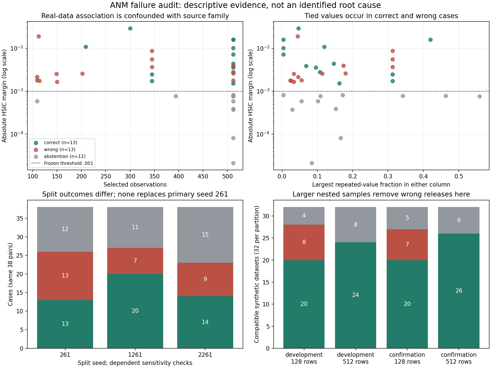

# ANM upstream failure diagnosis

**Saved-data audit; no new ANM fits, permutations or LLM calls.**
This is separate from the controlled LLM diagnostic-cue experiment.

Read [report.md](report.md) or the identical shared
[review document](../../docs/reviews/anm-failure-diagnosis.md).
The [reproduction guide](../../docs/experiments/anm-failure-diagnosis.md) explains
commands, definitions and limits.

- `metrics.json`: complete numeric results, source/runtime hashes and scope.
- `case-results.json` / CSV: every primary validation case and its split sensitivity.
- `real-attempts.json`: all 114 validation outcomes; dependent splits retained separately.
- `figures/`: standard Matplotlib PNG/SVG plots and their input/file hash manifest.
- `software-validation.log`: full repository checks, including 21 new regressions.
- `replay.log`: executed saved-data audit summary.
- `validation.json`: checks performed, exact counts, limitations and remaining questions.
- `source-manifest.json`: complete change-set inventory, excluding itself; hashes
  detect inconsistency but are not authenticated signatures.

The source archive contains 7,125 files, all independently checked against its
manifest. The audit checks 210 real and 352 synthetic saved attempts; repeated
splits/configurations/sizes are not additional independent datasets. Raw records
and production method settings remain unchanged.

Main observations: nine of 13 wrong primary cases change raw sign across saved
splits, but three stay wrong throughout. Shorter real samples have more errors, but
source family confounds that comparison. Compatible synthetic datasets improve
with larger samples, at a cost of some correct answers becoming abstentions.
Ties alone do not explain the failures. Five of 13 wrong cases have lower MSE in
the reference direction, showing that prediction fit and the ANM ranking differ.
No single causal root cause, numerical implementation defect, calibrated reliability
measure or new real-data accuracy improvement is established.

