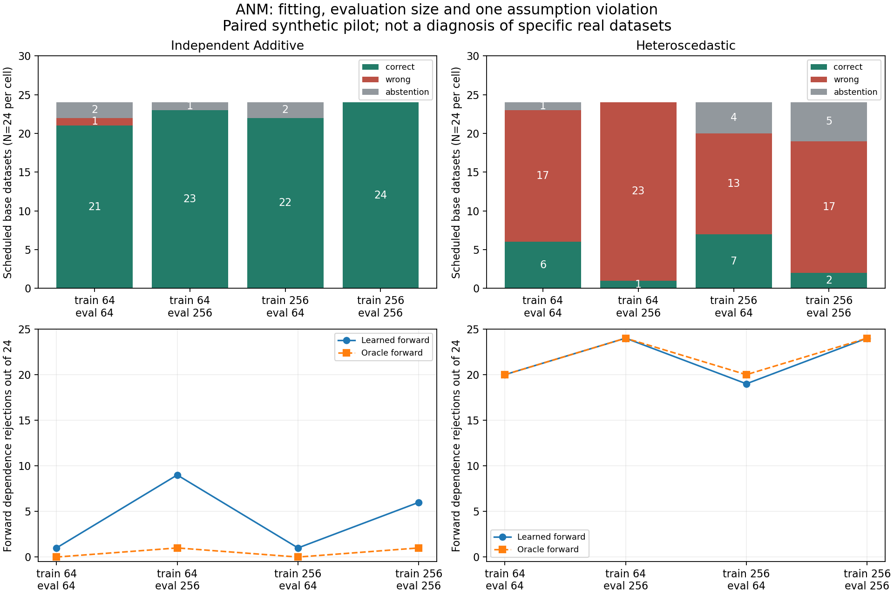

# Controlled ANM mechanism study

This is a **new synthetic experiment**, separate from the saved-data failure audit
and the LLM diagnostic-cue experiment. It does not tune on the opened real pairs.

Read the [interpretation](../../docs/reviews/anm-mechanism-study-v1.md),
[protocol](../../docs/experiments/anm-mechanism-study-v1.md), and generated
[complete tables](report.md).

At 256 training / 256 evaluation observations:

| Paired condition | Correct | Wrong | Abstain | N |
|---|---:|---:|---:|---:|
| Independent additive noise | 24 | 0 | 0 | 24 |
| Heteroscedastic noise | 2 | 17 | 5 | 24 |

With an oracle replacing only the true mean regression, the heteroscedastic cell
still had 2 correct, 16 wrong and 6 abstentions. This supports a model-mismatch
explanation **in these controlled simulations**; it does not diagnose any specific
real pair or establish a new deployable method.

## Files and units

- `run-records.tar.gz` and `manifest.json`: 1,793 hash-verified files, comprising
  preflight, full study, analysis, frozen numerical source and build context.
- `metrics.json`, `case-results.json`, `report.md`: readable analysis exports.
- `figures/`: standard Matplotlib PNG/SVG with input/file hash manifest.
- Validation and execution logs record the actual checks, not new inference.
- The study has **24 main base worlds**, paired across two regimes and four size
  combinations: 192 cells. Separate preflight uses two more worlds and 16 cells.
- The 208 experimental ANM requests each execute two production directional fits
  and two diagnostic reconstruction fits: 832 directional fits in total. Software
  tests perform additional small fixtures that are not scientific observations.
- The producer and fixed gamma/ridge/threshold were unchanged. Zero execution
  failures; zero LLM calls; no real-data fits; no parameter selection.
- No claim of external preregistration, general accuracy improvement or real root
  cause is made. Hashes are consistency checks, not authenticated signatures.

## Restore safely and replay without regression fitting

From this repository, create a fresh destination and verify every archived member
before extraction:

```sh
uv run --extra anm python - <<'PY'
from pathlib import Path
from causalbridge.evaluation.anm_failure_audit import verified_archive, materialize
bundle = Path('artifacts/anm-mechanism-study-20261121')
output = Path('runs/anm-mechanism-restored-01')
output.mkdir(parents=True, exist_ok=False)
files = verified_archive(bundle/'run-records.tar.gz', bundle/'manifest.json')
materialize(files, output)
PY
cd runs/anm-mechanism-restored-01/frozen-source
uv sync --frozen --dev --extra anm
uv run --extra anm python scripts/anm_mechanism_study.py analyze --plan ../full --output ../replayed-analysis
```

The exact frozen source is used because later code changes deliberately invalidate
live-plan source matching. All 57,024 main permutation statistics are recalculated
from saved vectors; no regression is refitted. The clean frozen-source replay was
executed and reproduced all three analysis files byte-for-byte. Python 3.12 and the
pinned NumPy version are required for this exact numerical replay.

Optional figure reproduction uses the current branch's renderer and an explicit
additional dependency, without changing production requirements:

```sh
uv run --with matplotlib==3.10.6 python scripts/plot_anm_mechanism.py --metrics artifacts/anm-mechanism-study-20261121/metrics.json --output runs/anm-mechanism-new-figures
```

Platform/font differences can affect image bytes. Numeric outputs are authoritative.


