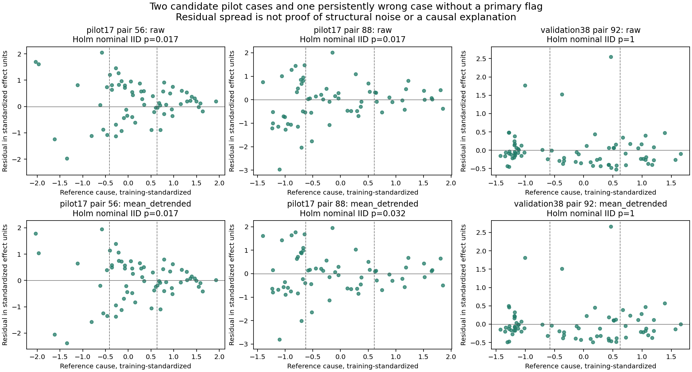
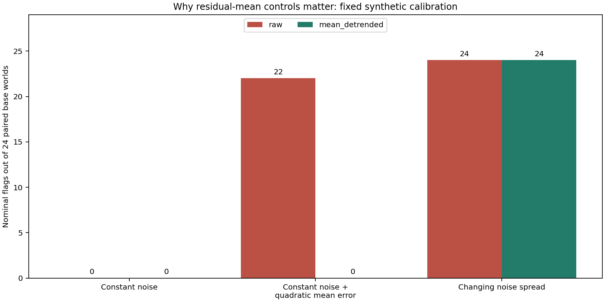

# Real-pair residual-spread follow-up

Read the [interpretation](../../docs/reviews/anm-real-noise-v1.md),
[frozen protocol](../../docs/experiments/anm-real-noise-v1.md), and
[complete primary/case tables](tables.md).

**Exploratory evidence, not proof of structural heteroscedasticity or a real root cause.**
Original ANM predictions/configurations remain unchanged. Numerical reconstructions
must match saved HSIC. Both directions are examined, with correct and abstaining
controls as well as wrong cases. Panels and repeated splits are not pooled.

Main observations:

- After residual-mean correction and nominal Holm adjustment: 4/8 wrong pilot cases
  flag, versus 0/6 correct pilot cases. Only pairs 56/88 also flag under the saved-
  order block sensitivity. Blocks are not a validated dependence correction.
- Later-panel reference directions: 2/10 available wrong and 2/11 available correct
  cases flag under mean-corrected IID analysis; this does not specifically separate
  wrong answers. Three wrong and two correct cases are unavailable under fixed bins.
- Primary persistent cases 91/92/108 do not have robust adjusted flags across all
  forms. A secondary favorable split is never substituted for the primary split.
- A quadratic mean-error control falsely flags 22/24 before correction and 0/24
  afterward; true heteroscedastic controls flag 24/24 in both forms. These reused,
  fixed examples cannot validate all real-data assumptions or guarantee specificity.

## Contents

- `run-records.tar.gz` / `manifest.json`: 1,405 individually hash-verified members,
  including all copied originals, vectors, diagnostic outputs, input archives and
  frozen source/build context. Hashes are consistency checks, not signatures.
- `metrics.json`, `real-records.json`, `calibration-records.json`: readable exports.
- `tables.md`: generated tables with availability and all primary cases.
- `source-context.json`: manually reviewed, hash-pinned description facts for the
  two strongest pilot candidates, selected after diagnostic outcomes.
- `figures/`: frozen-vector and calibration visuals; no additional fitting.
- Validation/execution/replay logs record actual checks.

The study contains 131 saved attempts (17 pilot + 38×3 splits), 262 reconstructed
directional fits and 72 calibration vectors from 24 reused base worlds. The latter
are paired controls, not 72 independent datasets. Of 1,336 planned form/scheme
checks, 1,264 are available; 72 are unavailable because of fixed-bin constraints.
A total of 2,526,736 permutation statistics was calculated per full diagnostic
replay. There are no new ANM direction decisions, LLM calls, tuned settings or
reference changes. Original ANM outcome counts remain 6C/8W/3A and 13C/13W/12A.

## Restore and replay without original ANM fits

From the branch, create a new verified restore directory:

```sh
uv run --extra anm python - <<'PY'
from pathlib import Path
from causalbridge.evaluation.anm_failure_audit import verified_archive, materialize
bundle = Path('artifacts/anm-real-noise-20261121')
output = Path('runs/anm-real-noise-restored-01')
output.mkdir(parents=True, exist_ok=False)
materialize(verified_archive(bundle/'run-records.tar.gz', bundle/'manifest.json'), output)
PY
cd runs/anm-real-noise-restored-01/frozen-source
uv sync --frozen --dev --extra anm
uv run --extra anm python scripts/anm_real_noise.py analyze --plan ../plan --output ../replayed-analysis --replay
```

This recomputes spread randomizations and the auxiliary cross-fitted quadratic
mean corrections from saved vectors; it does **not** fit the original ANM models.
A fresh environment replay with `numpy.linalg.solve` blocked passed and matched all
three output JSON files byte-for-byte. The original run does reconstruct the
frozen regressions, but never overwrites them or selects new directions.

The archived source is intentional: unrelated future source changes invalidate a
live plan, while archived source permits an exact saved-result replay.

Optional plot command from the branch:

```sh
uv run --with matplotlib==3.10.6 python scripts/plot_anm_real_noise.py --analysis artifacts/anm-real-noise-20261121 --output runs/anm-real-noise-figures-new
```

Exact image bytes can depend on fonts/platform; numerical records are authoritative.




