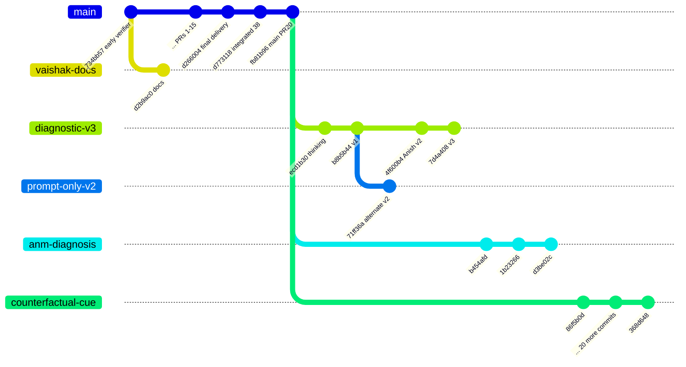

# CausalBridge branch lineage and experiment provenance audit

Audit date: 2026-11-22 (America/Los_Angeles). Repository: `mvaishak/CausalBridge`. Read-only investigation of Git history and saved artifacts; this document is the only file added in a detached audit worktree at `fb81b96a92c8cc78360276e54bd3d9be0a974e56`. No model or ANM experiment was run. `git fetch origin --no-tags` succeeded without pruning. Unless stated otherwise, facts below are from the fetched Git object database; GitHub PR state was queried from the public repository API on the audit date.

## Executive verdict

**V3 is the newest *diagnostic-following protocol lineage*, not the complete latest project state.** Its exact ancestry is `main fb81b96 → thinking ablation ecd1b30 → diagnostic v1 b8b5b44 → Anish v2 4f600b4 → v3 7d4a408`. It inherits the committed v1 and v2 implementation and archived failure analysis. It does **not** inherit Vaishak's independent prompt-only v2 commit `71ff36a`, the counterfactual synthetic cue branch `368d648`, or Anish's independent ANM diagnosis branch `d3be02c`. The prompt-only commit is an alternate v2 implementation; its draft design/plan files are absent from v3, while its main output-contract intent is implemented differently by `4f600b4`. The other branches contain substantial unique, scientifically useful work, but none should silently change the frozen final results.

**Recommended baseline:** retain `main` at `fb81b96` as the canonical submitted-result and production baseline. Use v3 only as the working baseline for a future *diagnostic-following* experiment, after reviewing its unrun live gate. Keep the ANM diagnosis and PR #21 in separate branches pending explicit scope and review. No branch demonstrates a validated accuracy fix. The most consequential submission risk is reporting the opened 38-pair panel as held-out, pooling repeated calls/fits as independent cases, or presenting a prepared cue protocol or failed preflight as a successful live study.

## Audit commands and interpretation rules

```sh
git fetch origin --no-tags
git for-each-ref --format='%(refname) %(objectname) %(committerdate:iso8601) %(authorname) %(upstream:short)' refs/heads refs/remotes/origin refs/tags
git worktree list --porcelain
git rev-list --left-right --count main...<branch>
git merge-base main <branch>
git merge-base --is-ancestor <ancestor> <descendant>
git log --all --graph --decorate --oneline --simplify-by-decoration
git cherry -v codex/diagnostic-investigation-v3-20261121 codex/cue-v2-prompt-only-20261121
git range-diff fb81b96..codex/cue-v2-prompt-only-20261121 fb81b96..codex/anm-evidence-investigation-20261121
git diff --name-status main...<branch>
```

`main...branch` is a merge-base diff; `main..branch` counts commits reachable only from the branch. Behind/ahead is relative to local `main`, which equals `origin/main` at audit time. A zero ahead count confirms commit incorporation, not necessarily perfect behavioral equivalence. An unmerged commit can still carry a redundant patch; `git cherry` supplies patch-ID evidence, and functional similarity is separately labeled. First unique is the oldest commit in `main..branch` when any; otherwise it is `—` because no unique commit remains. Git cannot prove a branch's creation command or original starting ref: “descended from” below means **commit ancestry**, not inferred branch-creation intent.

No `AGENTS.md`, `RTK.md`, or `PROCESS.md` was found in this repository or the supplied projectless workspace. The referenced files therefore supplied no additional executable instructions.

## Chronological timeline and verified lineage

| Date (local commit date) | Event and evidence |
| --- | --- |
| 2026-10-27 | Initial Vaishak verifier/orchestration `734bb57`; local documentation-only branch `d2b9ac0` remains one commit off that ancestor. |
| 2026-11-14–15 | Track A graph/witness and pilot, Track B integration/ANM provenance, checker and smoke fixes merged through PRs #1–9; merge records are in `git log --all --merges`. |
| 2026-11-17–18 | Pilot readiness, scoring lineage and ANM validation integrated via PRs #10–15. PR #12 was closed unmerged, while its branch was itself merged into another feature branch at `66126c2`; compare actual ancestry rather than PR state alone. |
| 2026-11-19 | Final delivery `d266004`, postmerge 38-pair live study `d773118`; later integrated through PRs #16–18. |
| 2026-11-20 | Failure-accounting corrections PRs #19–20 brought `main` to `fb81b96`. Current `main` and `origin/main` match. |
| 2026-11-21 | Thinking ablation `ecd1b30` from `fb81b96`; diagnostic v1 `b8b5b44`; independent prompt-only v2 `71ff36a`; Anish v2 `4f600b4`; v3 `7d4a408`. Separately, ANM diagnosis `b454afd → 1b23266 → d3be02c` and counterfactual cue v1 `86f5b0d → … → 368d648` start from `fb81b96`. PR #21 is open for the latter. |



The diagram compresses incorporated PR history, but each displayed branch point and commit chain is supported by `git log --format='%H %P %cs %s' main..<tip>` and `git merge-base`. `main` is an ancestor of all three 2026-11-21 research tips. The counterfactual branch has 21 unique commits, ANM diagnosis three, and v3 four. There is no ancestry from either independent branch into v3.

## Complete branch inventory

The table covers all 10 local heads and 25 fetched remote branch heads (including `origin/main`); `origin/HEAD` is a symbolic pointer, not another branch. No tags exist. Author is the HEAD commit author, not necessarily branch owner. “Dirty” records the worktree status at audit time; `—` means the ref has no checked-out worktree and cannot itself have uncommitted changes. The detached PR #16 review worktree at `c4c918e` is clean and is not a branch.

| Ref (scope) | HEAD | Date; author; latest subject | Upstream | Behind/ahead main | Merge base | First main-unique; count | Worktree/status | Classification |
| --- | --- | --- | --- | ---: | --- | --- | --- | --- |
| `codex/anm-evidence-investigation-20261121` | `4f600b4c507bda66c0923a1a1a6546347a0b28f3` | 2026-11-21;Anish Patnaik;Fix diagnostic investigation output contract with versioned v2 protocol | `origin/codex/anm-evidence-investigation-20261121` | 0/3 | `fb81b96a92` | `ecd1b3054b; 3` | — | INCORPORATED (in v3); HISTORICAL |
| `codex/cue-v2-prompt-only-20261121` | `71ff36ae0dfc528b831b8206afb8103bb11bf01a` | 2026-11-21;mvaishak;Add versioned cue investigation v2 contract | `—` | 0/3 | `fb81b96a92` | `ecd1b3054b; 3` | — | DIVERGED; SUPERSEDED |
| `codex/diagnostic-investigation-v3-20261121` | `7d4a408cc8fcb0b1238971c04141c0fd579a5a20` | 2026-11-21;mvaishak;Version diagnostic cue protocol with boolean evidence flags | `origin/codex/diagnostic-investigation-v3-20261121` | 0/4 | `fb81b96a92` | `ecd1b3054b; 4` | /Users/mvaishak/.codex/worktrees/68cd/DSC-261 Project; dirty 10 | CURRENT; DIVERGED |
| `codex/final-delivery-20261119` | `d26600459de4f341950e06623c0d2fac461c0ec3` | 2026-11-19;mvaishak;Complete CausalBridge final evaluation and deliverables | `—` | 16/0 | `d26600459d` | `—; 0` | — | INCORPORATED; HISTORICAL |
| `codex/pilot-readiness` | `a8ba5badeb74d8a143cc46ee3239bf4e7a58c6e4` | 2026-11-14;mvaishak;Prepare real-data pilot and fix evidence audit and failure accounting | `origin/codex/pilot-readiness` | 36/0 | `a8ba5badeb` | `—; 0` | — | INCORPORATED; HISTORICAL |
| `codex/postmerge-track-b-evaluation-20261119` | `fb81b96a92c8cc78360276e54bd3d9be0a974e56` | 2026-11-20;Arunima Anand;Merge pull request #20 from mvaishak/codex/clarify-failure-boundaries-20261120 | `origin/codex/postmerge-track-b-evaluation-20261119` | 0/0 | `fb81b96a92` | `—; 0` | — | INCORPORATED; HISTORICAL |
| `codex/qwen3-thinking-ablation-20261121` | `ecd1b3054bb290830f9a9dfa0b1b6763fe2030d1` | 2026-11-21;mvaishak;Add Qwen3 thinking ablation experiment | `origin/codex/qwen3-thinking-ablation-20261121` | 0/1 | `fb81b96a92` | `ecd1b3054b; 1` | /Users/mvaishak/Documents/ChatGPT/DSC-261-Project-Final-Delivery; clean | INCORPORATED (in v3); HISTORICAL |
| `codex/track-b-integration` | `b1718e7b6b59dff097e59566d28be7a37bba1f70` | 2026-11-14;Anish Patnaik;Merge pull request #5 from mvaishak/codex/anish-anm-provenance | `origin/codex/track-b-integration` | 52/0 | `b1718e7b6b` | `—; 0` | — | INCORPORATED; HISTORICAL |
| `codex/vaishak-verifier` | `d2b9ac06aadca0a7fb1a6003d17b3f7475886bea` | 2026-10-27;mvaishak;docs: explain Vaishak's workstream with technical brief and diagrams | `—` | 67/1 | `734bb573d4` | `d2b9ac06aa; 1` | — | DIVERGED; HISTORICAL |
| `main` | `fb81b96a92c8cc78360276e54bd3d9be0a974e56` | 2026-11-20;Arunima Anand;Merge pull request #20 from mvaishak/codex/clarify-failure-boundaries-20261120 | `origin/main` | 0/0 | `fb81b96a92` | `—; 0` | /Users/mvaishak/Documents/ChatGPT/DSC-261 Project; dirty 15 | CURRENT; HISTORICAL |
| `origin/codex/anish-anm-baseline-reproduction` | `3df87238a5551cb3ed53c04529114d82cddb300e` | 2026-11-18;Anish Patnaik;Pin validation sampling seed and reconcile producer status | `—` | 18/0 | `3df87238a5` | `—; 0` | — | INCORPORATED; HISTORICAL |
| `origin/codex/anish-anm-provenance` | `a0b314870cb17a5c1de82f879decf4b6fedce232` | 2026-11-14;Anish Patnaik;docs: format ANM example for CI | `—` | 53/0 | `a0b314870c` | `—; 0` | — | INCORPORATED; HISTORICAL |
| `origin/codex/anm-evidence-investigation-20261121` | `4f600b4c507bda66c0923a1a1a6546347a0b28f3` | 2026-11-21;Anish Patnaik;Fix diagnostic investigation output contract with versioned v2 protocol | `—` | 0/3 | `fb81b96a92` | `ecd1b3054b; 3` | — | INCORPORATED (in v3); HISTORICAL |
| `origin/codex/anm-failure-diagnosis-20261121` | `d3be02c76d7e20fa5395301e5e9c2922baa25133` | 2026-11-21;Anish Patnaik;Compare fixed ANM adequacy policies and document coverage trade-offs | `—` | 0/3 | `fb81b96a92` | `b454afdc16; 3` | — | DIVERGED; HISTORICAL |
| `origin/codex/benchmark-graph-witness` | `84d65a97aeeae5527958d1e22bb5f35808902e01` | 2026-11-14;Arunima Anand;feat: generate synthetic DAGs and validate causal witnesses | `—` | 64/0 | `84d65a97ae` | `—; 0` | — | INCORPORATED; HISTORICAL |
| `origin/codex/benchmark-small-pilot` | `6d18856218dd81876cd028738b54c6071cb6d8c0` | 2026-11-14;Arunima Anand;test: verify pilot labels and oracle isolation | `—` | 61/0 | `6d18856218` | `—; 0` | — | INCORPORATED; HISTORICAL |
| `origin/codex/diagnostic-investigation-v3-20261121` | `7d4a408cc8fcb0b1238971c04141c0fd579a5a20` | 2026-11-21;mvaishak;Version diagnostic cue protocol with boolean evidence flags | `—` | 0/4 | `fb81b96a92` | `ecd1b3054b; 4` | — | CURRENT; DIVERGED |
| `origin/codex/exact-known-witness-joint` | `bcf32ff6b5f088810976d906211ab998a3f2f281` | 2026-11-14;Arunima Anand;fix: export exact known-witness joint probabilities | `—` | 59/0 | `bcf32ff6b5` | `—; 0` | — | INCORPORATED; HISTORICAL |
| `origin/codex/faizah-pilot-diagnosis` | `a29dc4bda47cf5f04a1f835213170df34ff760b0` | 2026-11-18;Anish Patnaik;Fix pilot scoring lineage, roster eligibility and diagnosis accounting | `—` | 23/0 | `a29dc4bda4` | `—; 0` | — | INCORPORATED; HISTORICAL |
| `origin/codex/final-accounting-checks` | `4a4cb733be41db36d133602ac74d9bcc45ad1d8e` | 2026-11-20;Kris;Exclude personal handoff update from engineering changes | `—` | 11/0 | `4a4cb733be` | `—; 0` | — | INCORPORATED; HISTORICAL |
| `origin/codex/final-handoff-report-corrections-20261120` | `329d1a19b67a2e6cb9e9e4043bcb1c8dd191e862` | 2026-11-20;Arunima Anand;Point repository handoff to completed evaluations | `—` | 5/0 | `329d1a19b6` | `—; 0` | — | INCORPORATED; HISTORICAL |
| `origin/codex/pilot-audit-diagnosis` | `cf649343d6adc35cd7f98eb3b100ad7a0b5001d0` | 2026-11-17;Kris;fix: bind pilot diagnosis to original receipts and separate failures | `—` | 36/3 | `a8ba5badeb` | `c8eefb41ab; 3` | — | DIVERGED; HISTORICAL |
| `origin/codex/pilot-handoff-acceptance` | `cc4d30bc3c18fddc2a5cf189e82a633a2a4ac6f1` | 2026-11-15;Kris;docs: audit project readiness and record scorer mapping gap | `—` | 32/0 | `cc4d30bc3c` | `—; 0` | — | INCORPORATED; HISTORICAL |
| `origin/codex/pilot-output-review-tools` | `1d59c848637c09b32bbcdf97acf30b2446421467` | 2026-11-18;Kris;feat: prepare audited pilot outputs for human review | `—` | 23/1 | `a29dc4bda4` | `1d59c84863; 1` | — | DIVERGED; HISTORICAL |
| `origin/codex/pilot-readiness` | `a8ba5badeb74d8a143cc46ee3239bf4e7a58c6e4` | 2026-11-14;mvaishak;Prepare real-data pilot and fix evidence audit and failure accounting | `—` | 36/0 | `a8ba5badeb` | `—; 0` | — | INCORPORATED; HISTORICAL |
| `origin/codex/pilot-record-results` | `2780ba2e4947d498185ea27ff0df04fbfad3eac8` | 2026-11-20;Kris;Make original pilot reproduction self-contained and mark superseded rerun plan | `—` | 15/0 | `2780ba2e49` | `—; 0` | — | INCORPORATED; HISTORICAL |
| `origin/codex/pilot-scorer-mapping-fix` | `66126c2113d32a26f5b9f36e21f6ed46a40dc4d0` | 2026-11-17;KrisDcosta;Merge pull request #13 from mvaishak/codex/pilot-audit-diagnosis | `—` | 36/4 | `a8ba5badeb` | `c8eefb41ab; 4` | — | DIVERGED; HISTORICAL |
| `origin/codex/postmerge-track-b-evaluation-20261119` | `d773118951986a2bd25d57a98adb4c9d0881a6b9` | 2026-11-19;mvaishak;Deliver integrated Track B live evaluation and final research updates | `—` | 13/0 | `d773118951` | `—; 0` | — | INCORPORATED; HISTORICAL |
| `origin/codex/qwen3-thinking-ablation-20261121` | `ecd1b3054bb290830f9a9dfa0b1b6763fe2030d1` | 2026-11-21;mvaishak;Add Qwen3 thinking ablation experiment | `—` | 0/1 | `fb81b96a92` | `ecd1b3054b; 1` | — | INCORPORATED (in v3); HISTORICAL |
| `origin/codex/track-a-ten-group-pilot` | `311cfeb0cddd1d06269d9b22c304a213ec070d7b` | 2026-11-14;Arunima Anand;Add validated ten-group Track A pilot | `—` | 41/0 | `311cfeb0cd` | `—; 0` | — | INCORPORATED; HISTORICAL |
| `origin/codex/track-b-integration` | `8ca1f11521cdab155d3197769d0d07cc6bac302d` | 2026-11-14;mvaishak;docs: prepare Track B teammate integration and smoke checks | `—` | 61/0 | `8ca1f11521` | `—; 0` | — | INCORPORATED; HISTORICAL |
| `origin/codex/track-b-integration-acceptance` | `b8c670dc32fd34551cff9b4a8de0d2dadf450487` | 2026-11-14;Kris;docs: reconcile knowledge bank with merged fixes and PR 9 | `—` | 35/0 | `b8c670dc32` | `—; 0` | — | INCORPORATED; HISTORICAL |
| `origin/experiment/counterfactual-anm-cue-v1-20261121` | `368d6486261452ff7e5fee85f75e1a113e48509b` | 2026-11-21;Arunima Anand;Apply Ruff test fixture path formatting | `—` | 0/21 | `fb81b96a92` | `86f5b0d764; 21` | — | DIVERGED; CURRENT |
| `origin/main` | `fb81b96a92c8cc78360276e54bd3d9be0a974e56` | 2026-11-20;Arunima Anand;Merge pull request #20 from mvaishak/codex/clarify-failure-boundaries-20261120 | `—` | 0/0 | `fb81b96a92` | `—; 0` | — | CURRENT; HISTORICAL |
| `origin/pilot-case-diagnosis` | `73fe1dc48bd8a8e7457cde9451109d79a3c5a165` | 2026-11-17;Anish Patnaik;Relocate Faizah evaluation work to codex/faizah-pilot-diagnosis | `—` | 31/1 | `7a886f1937` | `73fe1dc48b; 1` | — | DIVERGED; HISTORICAL |

Local upstream fields are shown where configured; remote-tracking refs have no upstream by definition. The only checked-out branch worktrees are `main` (15 untracked paths before creating this audit worktree), v3 (10 status entries), and thinking ablation (clean). The new detached audit worktree is excluded from branch rows. Local `codex/postmerge-track-b-evaluation-20261119` is at `main`, while its remote-tracking namesake is at earlier `d773118`; do not conflate them.

## Branch-to-main and branch-to-v3 comparison

| Branch/family | Commit relationship | Material difference versus main and v3 | Action |
| --- | --- | --- | --- |
| V3 `7d4a408` | Four commits ahead of `main`; `4f600b4` and `b8b5b44` are exact ancestors. | Adds ablation, v1 diagnosis/protocol, v2 contract/failure audit, v3 boolean evidence flags. Neither main nor ANM diagnosis has these. | Preserve as a versioned research protocol. Live v3 work is pending. |
| Prompt-only v2 `71ff36a` | One separate commit after shared `b8b5b44`; `git cherry -v v3` marks it `+`. `git range-diff` does not match it to `4f600b4`. | Its design and plan documents `docs/superpowers/{specs,plans}/2026-11-21-cue-investigation-v2*` and alternate prompt-only output contract are absent from v3; Anish's v2 solves the contradictory direction/abstention problem through a different implementation. | Preserve for rationale; no blind cherry-pick into v3. Review docs if they contain decisions not captured in v3. |
| Counterfactual synthetic cue v1 `368d648` | 21 commits after `fb81b96`, no shared feature commits with v3. | Adds `examples/diagnostic_counterfactual_probe.py`, tests, frozen ZIP, study document. Uses 24 **new synthetic** mechanisms, four arms, 96 planned calls, generic labels, `think=false`, 4096/512. V3 uses 17 opened real pairs, five arms, both thinking settings, 8192/4096. | Preserve PR #21 as an independent prepared experiment. It is not a v3 fix and has no live result yet. |
| ANM diagnosis `d3be02c` | Three commits after `fb81b96`, no shared feature commits with v3. | 136 files under `artifacts/anm-*`, `configs/anm-*`, scripts, analysis code, tests, and interpretive docs are absent from both main and v3. Includes saved-data audit, controlled mechanism study, residual-spread and robustness analyses, independent decision audit and exploratory adequacy-rule replay. | Preserve and review separately; integrate research docs/artifacts only with scope and provenance checks, not a production gate. |
| Older final/pilot/ANM/Track A branches with 0 ahead of main | Exact ancestor or commits incorporated by main merge history; v3 descends from main. | No Git-unique commits remain, although archived run context and some untracked main files still matter. | Archive candidates after worktree/ignored-artifact checks. Do not delete now. |
| `codex/vaishak-verifier` `d2b9ac0` | One unique commit from the early verifier ancestor, 67 behind main. | Adds `docs/technical-brief/CausalBridge_Vaishak_Technical_Brief.md`, a DOCX copy and diagrams; documentation work is not in main or v3. | Preserve as historical documentation, selectively copy only if useful to current architecture. |
| `origin/codex/pilot-output-review-tools` `1d59c84` and `origin/pilot-case-diagnosis` `73fe1dc` | One unique commit each versus main; old branch points. | Pilot output review tooling and relocation marker respectively are not exact ancestors. | Review before archival; no evidence yet that either is required for the final scorer. |
| `origin/codex/pilot-audit-diagnosis` `cf64934`, `origin/codex/pilot-scorer-mapping-fix` `66126c2` | Diverged from older pilot-readiness; PR #13 merged into the latter, PR #12 closed unmerged. | Portions of pilot diagnosis were later integrated via PRs #10/#14; three/four branch commits remain Git-unique. | Preserve as historical alternate implementation; inspect targeted diffs before any cherry-pick. |

The `INCORPORATED` label in the inventory means a branch has no commits unique to **main**. The two v3 ancestors are incorporated into **v3**, but remain absent from **main**. Conversely, the independent 2026-11-21 branches are absent from both. Exact ancestry establishes `main ⊂ v3`; it does not establish that v3 contains every later research branch.

### Missing and unique change inventory

| Commit(s) | Files / change | Significance | Integration judgment |
| --- | --- | --- | --- |
| `71ff36a` | Alternate v2 prompt/schema, tests, two design/plan docs. | Attempted to remove contradictory generated direction/abstention fields. V3 instead inherits `4f600b4`'s fuller, versioned single-decision contract and fail-fast checks. | Functional intent partly covered; preserve the alternate docs and compare details, do not merge its code wholesale. |
| `b454afd`, `1b23266`, `d3be02c` | ANM audit scripts/code/tests, six artifact families and review docs. | New, reproducible *exploratory* evidence on ANM failure mechanisms and adequacy-policy trade-offs. No production inference fix. | Worth reviewing into a future research record; keep original branch/artifacts intact. Avoid changing submitted headline counts. |
| `86f5b0d` through `368d648` | Frozen synthetic cue ZIP, probe, tests, protocol doc. | Separately frozen design with new source mechanisms; potentially more independent mechanistic test than v3's opened real cohort, but still unexecuted. | Keep PR #21 separate and review. Do not call it a completed finding or mix its 96 cells with v3's 170. |
| `d2b9ac0` | Early Vaishak workstream brief and diagrams. | Historical design context; no demonstrated production fix. | Optional documentation extraction only. |
| `1d59c84`, `73fe1dc`, `cf64934`–`66126c2` | Pilot review/diagnosis lineages. | Git-unique old tooling or handoff changes; later main scorer and roster fixes address related needs but exact equivalence was not proven for every file. | Preserve until file-level review; not an urgent submission integration. |

No clear **accidentally omitted production fix** was established. The missing ANM and counterfactual work is independent research, not a patch that v3 should automatically inherit. `git cherry` marked the alternate v2 commit and counterfactual commits as non-equivalent patch IDs; the v2 branches share a goal but differ in implementation. This audit did not claim equivalence from similar filenames.

## Experiment provenance matrix

“Recorded” means a checked-in config, manifest, raw archive, or report states the value; a branch tip is not necessarily the revision that generated an archived run. Common LLM digest where pinned: `sha256:500a1f067a9f782620b40bee6f7b0c89e17ae61f686b92c24933e4ca4b2b8b41` for `qwen3:8b`. Source hashes and full per-file digests are in the named manifests/archives, not repeated here. For several historical runs a single exact generating Git SHA is not independently attested by server receipts; treat code revision as recorded or inferred accordingly.

| Study and canonical artifact | Recorded source / protocol; dataset and unit | Calls, model/settings, checker | Result and scope; provenance limit |
| --- | --- | --- | --- |
| Track A ten-group construction; `data/pilot/track_a_10_groups.jsonl`, oracle and benchmark tests | 10 synthetic DAG groups, 50 questions (29 answerable); PR #7/`311cfeb` lineage | 0 model calls; exact witness/numerical fixtures | Deterministic case validity only, not model accuracy. |
| Track A live 50; `artifacts/final-delivery/track-a-live/traces.jsonl.gz`, `analysis/track-a-case-results.json`, `docs/reviews/final-track-a-evaluation.md` | Delivery branch `d266004` lineage; 10 graph groups, 50 questions | 102 actual model stages; qwen3:8b pinned digest, temp 0, seed 261, think off, ctx 8192, output 1024; original verifier and oracle scorer | 1 correct released, 1 wrong released, 24 missed answerable, 3 planning errors, 21 correct abstentions. Coverage 2/50. SHA-256 of trace archive `f7637886005c2c3f56d7b60c8f3e6d4c856262434cdbec7474b38f6f60545813`. Exploratory grouped synthetic evaluation. |
| Original Track B pilot; `artifacts/final-delivery/track-b-pilot/original-real-pilot-01.zip`, `artifacts/record-results-2026-11-19/` and `docs/reviews/final-track-b-evaluation.md` | Recorded session/source hashes; pilot-readiness `a8ba5ba` lineage; 17 Tübingen pairs, 7 source groups, 128-row ANM | 136 live calls, one per E1–E4 × S0/S1; qwen3:8b pinned, think off, temp 0, seed 261, ctx 4096, output 512. S2/checker and gate reuse outputs. | E4 6 correct/8 wrong/3 abstain; weighted answered accuracy 40.0%. Exploratory; score lineage reproduced from saved records. Original session SHA must be read from its archive, not inferred from later report commit. |
| Track B integrated 38; `artifacts/final-delivery/postmerge-track-b/integrated-38-resumed-live.tar.gz`, provenance audit, case results/metrics and `docs/reviews/final-track-b-integrated-38.md` | `configs/final-track-b-integrated-38.json`; postmerge `d773118` lineage; 38 Tübingen pairs/12 groups, up-to-512-row PR #15 ANM, opened labels | 304 accepted live replies: 51 byte-matched reuse from interrupted attempt + 253 new calls; three failed transport retries. Same qwen3 digest, temp/seed, ctx 4096/output 512, think off; 152 cached S2 checks. | E4/S0/S1 and ANM-only 13 correct/13 wrong/12 no release. E4 11 model abstentions plus one binding failure; ANM-only 12 method abstentions. S2 removes 3 correct answers. Exploratory **after label inspection**, not held-out. Interrupted archive contains 253 transport failures and is not a separate scored panel. |
| ANM 128-row validation; `artifacts/final-delivery/anm-128-panel/original-run.tar.gz` and `docs/reviews/anm-independent-validation.md` | 48 synthetic datasets, 32 compatible; frozen original gate; pilot-readiness lineage | 192 repeated orientation/split fits; no LLM. KRR/HSIC gamma 1, ridge .1, threshold .001 | Compatible primary 20 correct/8 wrong/4 abstain; preregistered recovery/stability gate failed. Repeats are not independent datasets. |
| ANM 512-row synthetic / 38-pair real / four-pair development; `artifacts/anm-experiments-2026-11-18/run-records.tar.gz`, `manifest.json`, summaries and `docs/reviews/final-anm-analysis.md` | PR #15 `3df8723` lineage; 32 new compatible synthetic cases; 38 real pairs/12 groups (22 full 512 rows); four development pairs | No LLM; primary split 261 and two dependent sensitivity splits, 114 validation attempts; 7,125 archive members checked. | Synthetic 26/0/6; real primary 13/13/12 and weighted 48.1% answered accuracy. Development had no primary correct answers. Real labels were opened before integrated 38. |
| Thinking on/off ablation; `artifacts/qwen3-thinking-ablation-8192-4096-01/run-records.tar.gz`, `manifest.json`, review and validation JSON | Starting commit recorded as `fb81b96`, committed at `ecd1b30`; exact 136 archived S0/S1 E1–E4 inputs on same 17 opened pairs | 272 final calls, 136 matches; qwen3 pinned digest, temp 0/seed 261, ctx 8192/output 4096, think false/true; separate 2-call activation and 16-call preflight. Archive SHA `b5248b5c9d42358ed1e72d9d7a28459d6c98d2b94fdfaae43950d2b19b919327`. | S0 correct yield 6/68 off vs 12/68 on; S1 6/68 vs 11/68. One S1 off failure, all preserved. Exploratory within opened pilot; 272 calls are 17 independent real pairs, not 272 data units. All valid final claims were empty, so checker non-rejections do not test typed evidence quality. |
| Diagnostic v1; `artifacts/diagnostic-investigation-v1/`, v1 protocol/review | `b8b5b44` source; 17 opened pilot pairs, five cue arms, think off/on, 170 planned full calls plus 20 synthetic preflight. Source manifest hashes. | Same qwen3 digest, temp 0/seed 261, ctx 8192/output 4096. Software smoke 190 scripted cells; two preserved first-cell live preflight replies failed Python cross-field validation. Runs 01/02 had 20 transport failures each; run 03 lacks a durable reply. | No successful live preflight or full causal-cue experiment. Saved-result diagnosis reuses 136 pilot + 272 ablation observations; 102 E3/E4 comparisons are dependent reanalyses, not new evidence. V1 failures remain failures. |
| Diagnostic v2; `artifacts/diagnostic-investigation-v2/`, `docs/reviews/diagnostic-preflight-failure-audit.md` | Anish commit `4f600b4` after v1; changed output contract to single `decision` enum, retained 17-pair design. Manifest notes scripted smoke's `source_commit` is earlier `b8b5b44` while source hashes bind modified local code. | 20 + 170 scripted cells, **0 live v2 calls**; same model/generation settings planned. Fail-fast preflight; checker derives direction/abstention, duplicate-key rejection. | Corrects v1 interface mismatch in code and tests; no model accuracy or cue-following claim. Scripted source-commit field is not proof that `b8b5b44` itself contained v2 code. |
| Diagnostic v3; config, `docs/experiments/diagnostic-investigation-v3.md`, `tests/test_diagnostic_investigation_v3.py` | `7d4a408` after Anish v2; same 17 opened pairs/five arms/two thinking settings, versioned boolean evidence basis. | Four planned synthetic diagnostic calls, then 20 planned preflight, then 170 planned full calls only after gates. Same pinned model/settings. | Offline implementation and handoff only. No archived live v3 replies or full analysis found in checked-in tree. Do not report v3 outcome. |
| Counterfactual cue v1 PR #21; tracked frozen ZIP and `docs/experiments/diagnostic-counterfactual-study-v1.md` | `368d648` independent main fork; 24 new generated mechanisms, 12 each direction, 96 prepared arm cells, exact ZIP internal SHA locks. | Planned qwen3 pinned, think false, temp 0/seed 261, ctx 4096/output 512; raw-first audited runner; no accepted live run in branch. | Prepared mechanism test only. Generic names and constructed “card” scores cannot be called real ANM fit; not directly comparable to v3 real-case protocol. |
| ANM failure/adequacy follow-ups; `artifacts/anm-*-20261121/`, `docs/reviews/anm-diagnosis-summary.md`, adequacy review | `b454afd`→`1b23266`→`d3be02c` independent main fork; replay of opened 17+38, 24 base synthetic worlds in mechanism study; 192 factorial cells, 16 preflight; additional residual/robustness/policy replays | 0 LLM; ANM mechanism study uses 24 independent worlds, 192 repeated cells; adequacy replay 20 configurations/550 repeated rows over 55 real cases. Raw/source manifests and run archives exist per study. | Mechanism study: at 256/256 independent-additive 24/0/0 vs cause-dependent noise 2/17/5; demonstrates a controlled failure mechanism, not a real-case cause. Adequacy gates lose correct answers and depend on permutation scheme. Post-outcome exploratory, not deployment validation. |

## Dataset, protocol, and scientific consistency findings

1. **Holdout language is the main hazard.** The 17-pair pilot and 38-pair validation have zero pair-ID and source-group overlap per the frozen roster, but the 38 reference outcomes were inspected in ANM validation before the LLM integrated panel. Thus source disjointness does not restore a blind held-out claim. All later v1/v2/v3 cue protocols on the 17 pilot pairs are exploratory. The synthetic PR #21 uses new generated mechanisms, a different estimand and model context, and is still unrun.
2. **The original pilot and integrated 38 are not effect-size replications.** The former uses 128-row ANM, 17 pairs/7 groups and selected weights; the latter up-to-512 rows, 38 pairs/12 groups and opened labels. E4 copies ANM's wrong arrows in both, but E3→E4 weighted correct-yield contrast changes from −4.1 to +12.7 percentage points. The 38-panel paired source-bootstrap interval (−19.9,+46.3) spans zero. Report both without pooling or claiming reliable improvement.
3. **Execution categories must stay distinct.** Track A's three planning errors, integrated 38's one binding failure, its interrupted run's 253 transport failures, v1's transport/schema failures, and the thinking ablation's one truncation/failure are not abstentions. Checker rejections may overlap upstream abstention and are not model outputs. Original ANM 12 method abstentions differ from E4's 11 model abstentions plus one failure, despite identical released directions.
4. **Checker semantics changed across studies.** Original Track B checks typed evidence citations, but it cannot validate causal truth. Thinking ablation's valid outputs all have `claims=[]`, making zero checker rejections vacuous for typed citations. Diagnostic v1 allowed a JSON-schema-valid contradiction between `predicted_direction` and `abstained`; Python rejected it. V2 replaces these with one enum, v3 changes evidence-basis array to four booleans. Their prompts/schemas differ, so any future live outcomes are not literal replications of v1 or historical E4.
5. **The numbers have different independence units.** Track A: 10 graphs; original pilot: 17 pairs/7 groups; later real panel: 38 pairs/12 groups; ablation: 136 matched prompts but 17 pairs; ANM synthetic follow-up: 24 worlds with repeated factorial cells; policy replay: 55 underlying real cases, not 550 observations. Neither fixed seed nor multiple split/call count creates new independent datasets.
6. **ANM follow-up strengthens interpretation, not prediction.** Independent additive versus cause-dependent noise distinguishes the frozen method under one generator, while real residual-spread flags and adequacy policies depend on assumptions and already-opened cases. The attractive 90% selective accuracy in a 10/38 block-policy subset loses four correct answers and fails to generalize to the pilot or IID scheme. Do not promote it into the final report as a validated repair.
7. **Recorded revision caveat.** V2's `smoke-manifest.json`/README explicitly says its `source_commit` points to pre-correction `b8b5b44` even though source hashes bind changed local files. This is a concrete mismatch between a convenient commit field and the code actually exercised. The tracked final commit `4f600b4` contains the corrected source, but the smoke log is not a run from a clean checkout of that commit. Archived raw/source hashes are stronger evidence than an inferred branch label; the exact backend binary is not cryptographically attested.
8. **Documentation chronology.** `docs/reviews/final-execution-audit.md` describes historical pending work and cites an earlier main `7c7198d`; `final-track-b-integrated-38.md`, current `final-results-analysis.md`, and checked-in metrics are the later canonical integrated results. The v1 diagnostic README explicitly says no new controlled-cue full live inference, despite its saved-result diagnosis metrics. Keep historical docs as dated records; avoid copying an older “pending” statement into a current submission without context.

## Classification and preservation plan

The inventory table applies the requested categories per ref. For practical archiving: branches with zero ahead of main and no active worktree are candidates for **reference archival only**, after checking any ignored local run assets. Do not equate a clean branch with dispensable raw evidence. Main has 15 untracked paths including ANM review drafts; v3's active worktree has 10 status entries. Those files were not read as canonical committed evidence and should be inventoried by their owners before cleanup. No deletion or branch movement is recommended by this audit.

1. Freeze `main fb81b96` as the result baseline and cite its canonical Track A/Track B/ANM artifact paths. If a submission document is revised, carry forward failure/holdout caveats and never rewrite old raw archives.
2. Preserve `7d4a408` as the v3 protocol baseline for future diagnostic-following work. Run its four-cell diagnostic and 20-cell preflight only under a separately authorized live study; a full 170-cell run follows only if gates pass. Do not label prepared cells as results.
3. Keep `d3be02c` and `368d648` separate until review. ANM code is explanatory/experimental; PR #21 is a different synthetic intervention. A future consolidation can cherry-pick or merge documentation and tests after checking conflicts and scientific scope, while retaining source branches and manifests.
4. Preserve `71ff36a`, `1d59c84`, `73fe1dc`, and the PR #12/#13 side lineage as historical unique work until targeted file review. Treat merged older branch heads as archive candidates, not urgent removals. No branch deletion is warranted by this report.

## Unresolved questions and verification limits

- The public GitHub API returned 21 PRs, with PR #21 open and #1–20 merged except #12 (closed unmerged); see the PR inventory below. Branches without PRs may have private review discussion outside this API; no such discussion was inferred.
- This audit did not execute every saved replay or independently rehash every member of the large ANM and LLM archives. It cross-checked checked-in manifests, archive locations, config values and report arithmetic/denominators. Historical reports themselves describe deeper verification. Corruption after those checks remains possible until a fresh full manifest verification is performed.
- Exact Git SHA for every original experimental *execution* is not always embedded in the run or attested by the server. Where the matrix says “lineage,” it is an inference from commit history; source-file hashes and raw journals are the better reproducibility keys. The oldest ignored original run directories and two v1 live failure archives may reside outside checked-in Git, so a fresh clone alone cannot reproduce every narrative detail.
- The v3 worktree has uncommitted entries; this report considers committed `7d4a408` only. It does not decide whether those local changes should be kept. Likewise, main's untracked ANM files could contain useful unpublished work and were not modified.
- “Created from main” cannot be conclusively proved from Git objects, only a common ancestor and reachable commit path can. The diagram shows those verified relationships. The old local `codex/vaishak-verifier` branch and pilot side branches require targeted file-by-file historical review before saying their unique docs/tools are functionally superseded.
- No new held-out source-separated real panel is established in the pinned snapshot. Any claim that a new threshold, checker, ANM adequacy gate, or cue prompt improves causal-direction accuracy requires a separately frozen evaluation design and new suitable data.

## Pull request inventory (GitHub API snapshot)

| PR | Status | Head → base | Merge / branch-history significance |
| --- | --- | --- | --- |
| #1 | merged | `benchmark-graph-witness` → `main` | Track A generator/witness |
| #2 | merged | `benchmark-small-pilot` → `main` | Small evidence pilot |
| #3 | merged | `exact-known-witness-joint` → `main` | Exact joint fix |
| #4 | merged | `track-b-integration` → `main` | Track B integration |
| #5 | merged | `anish-anm-provenance` → `main` | ANM request provenance |
| #6 | merged | `kris-track-b-plan` → `main` | Checker/evaluation plumbing |
| #7 | merged | `track-a-ten-group-pilot` → `main` | Track A pilot |
| #8 | merged | `track-b-live-smoke-fixes` → `main` | Live smoke fixes |
| #9 | merged | `track-b-integration-acceptance` → `main` | Acceptance checks |
| #10 | merged | `pilot-readiness` → `main` | Original pilot readiness |
| #11 | merged | `pilot-handoff-acceptance` → `main` | Handoff checks |
| #12 | closed, unmerged | `pilot-scorer-mapping-fix` → `pilot-readiness` | Do not infer that no related code landed: #13 merged into its head and later main branches include related fixes. |
| #13 | merged | `pilot-audit-diagnosis` → `pilot-scorer-mapping-fix` | Feature-branch merge `66126c2` |
| #14 | merged | `faizah-pilot-diagnosis` → `main` | Roster/diagnosis integration |
| #15 | merged | `anish-anm-baseline-reproduction` → `main` | ANM validation archive |
| #16 | merged | `pilot-record-results` → `main` | Pilot result package |
| #17 | merged | `final-accounting-checks` → `main` | Final delivery/analysis |
| #18 | merged | `final-handoff-report-corrections-20261120` → `main` | Report correction |
| #19 | merged | `separate-failures-from-abstentions-20261120` → `main` | Outcome accounting |
| #20 | merged | `clarify-failure-boundaries-20261120` → `main` | Current main tip `fb81b96` |
| #21 | open | `experiment/counterfactual-anm-cue-v1-20261121` → `main` | Prepared, not live-executed study |

The API's `merged_at` fields support these states; merge commits in local history support the major main integrations. A merged PR can leave a remote branch head pointing to an older pre-merge commit. PR state, branch-tip ancestry, and patch equivalence answer different questions.
